# Accesibilidad — Planta Libre (front)

Evidencia de la revisión de accesibilidad del front (React 19 + Vite). Generada por
`npm run a11y` el 2026-11-26 contra http://localhost:8088, con el sistema completo levantado
(`docker compose up`: base, broker, API y front).

## Qué se mide

| Herramienta | Alcance | Criterio |
| --- | --- | --- |
| [axe-core](https://github.com/dequelabs/axe-core) via `@axe-core/playwright` | Las cinco pantallas, reglas WCAG 2.1 A y AA | Ninguna violación **crítica** ni **seria** |
| [Lighthouse](https://developer.chrome.com/docs/lighthouse) 13, perfil escritorio | Performance, accesibilidad, buenas prácticas y SEO | **Performance ≥ 90** en las cinco pantallas (mediana de tres corridas) |
| Capturas a 360, 768 y 1280 px | Reflow y lectura en móvil, tablet y escritorio | Sin contenido cortado ni solapado |

La suite de Playwright corre la misma auditoría de axe en cada ejecución
(`e2e/accesibilidad.spec.ts`), así que una regresión de accesibilidad rompe el CI.

## Resultados de axe-core

| Pantalla | Violaciones críticas o serias | Avisos leves |
| --- | --- | --- |
| Ingreso | Ninguna ✅ | 0 |
| Empresas | Ninguna ✅ | 0 |
| Plano de un piso | Ninguna ✅ | 0 |
| Mis reservas | Ninguna ✅ | 0 |
| Agenda del día | Ninguna ✅ | 0 |

## Resultados de Lighthouse (escritorio, 1280 px)

| Pantalla | Performance | Accesibilidad | Buenas prácticas | SEO |
| --- | --- | --- | --- | --- |
| Ingreso | 99 ✅ | 100 ✅ | 100 ✅ | 83 ⚠️ |
| Empresas | 100 ✅ | 100 ✅ | 100 ✅ | 82 ⚠️ |
| Plano de un piso | 98 ✅ | 99 ✅ | 100 ✅ | 82 ⚠️ |
| Mis reservas | 99 ✅ | 100 ✅ | 100 ✅ | 82 ⚠️ |
| Agenda del día | 100 ✅ | 100 ✅ | 100 ✅ | 82 ⚠️ |

**Performance mínima: 98** ✅ (umbral 90).

Los reportes completos quedan en `docs/evidencia/accesibilidad/lighthouse-<pantalla>.json`.

> La columna de performance es la **mediana de tres corridas** del mismo build; las tres mediciones de
> cada pantalla quedan en `docs/evidencia/accesibilidad/resumen.json`. Se usa la mediana porque el
> perfil escritorio de Lighthouse comparte CPU con el resto del sistema y un pico de carga ajeno no
> debe decidir el número.

## Capturas

### 360 px

| Pantalla | Captura |
| --- | --- |
| Ingreso | 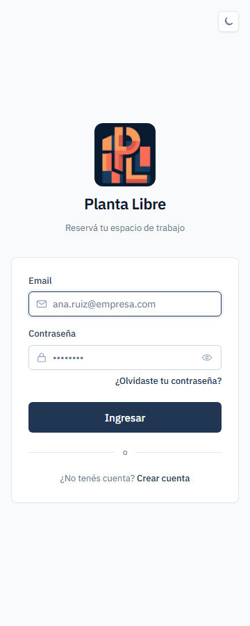 |
| Empresas | 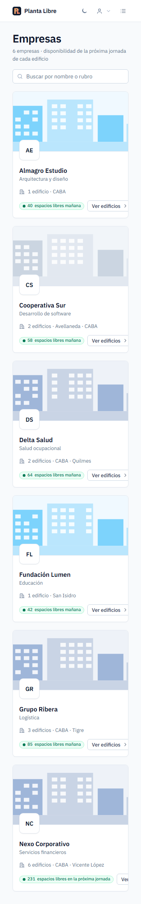 |
| Plano de un piso | 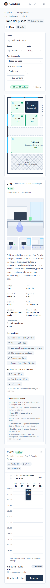 |
| Mis reservas | 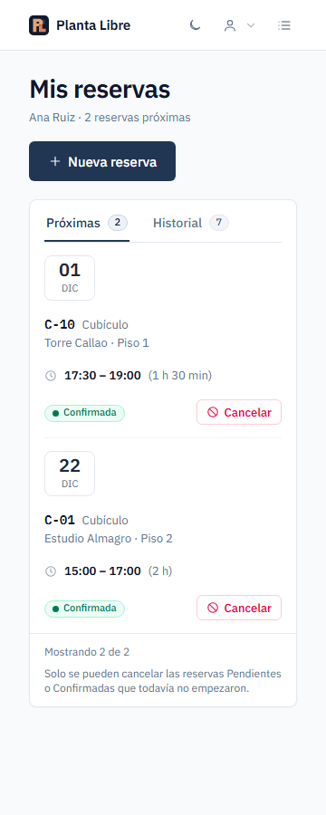 |
| Agenda del día | 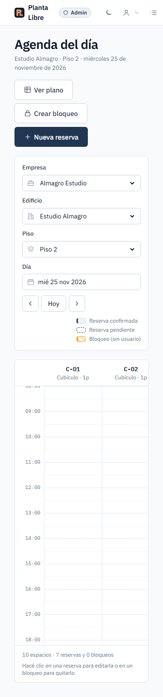 |

### 768 px

| Pantalla | Captura |
| --- | --- |
| Ingreso | 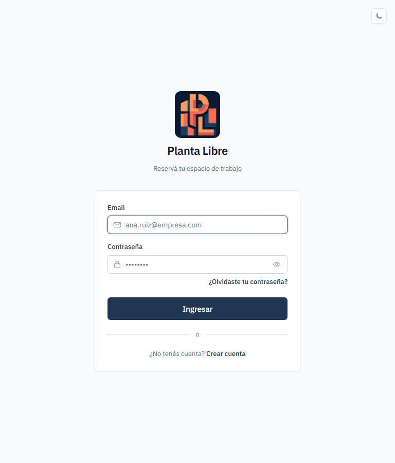 |
| Empresas | 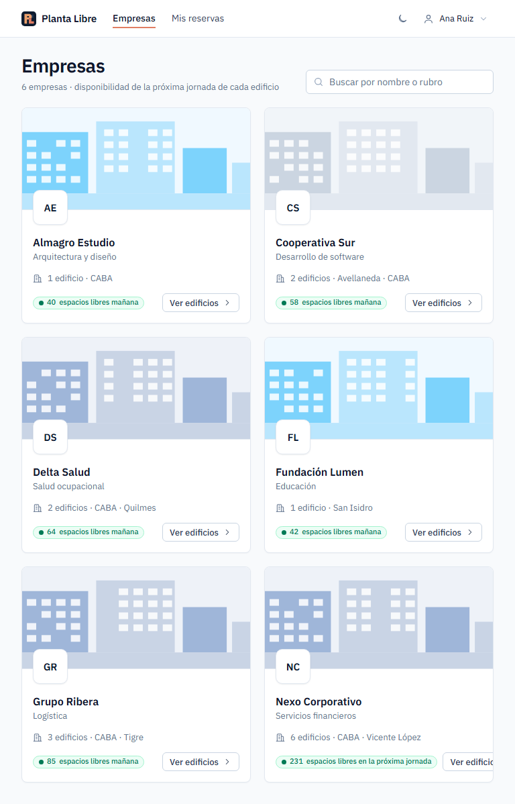 |
| Plano de un piso | 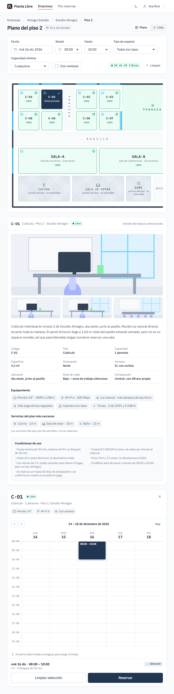 |
| Mis reservas | 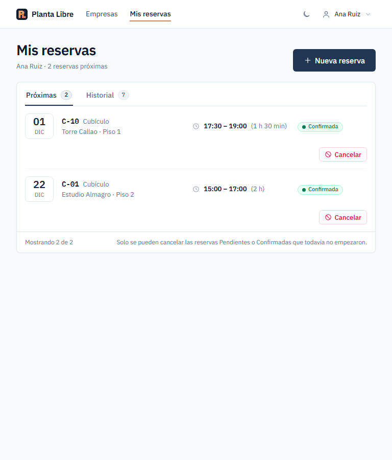 |
| Agenda del día | 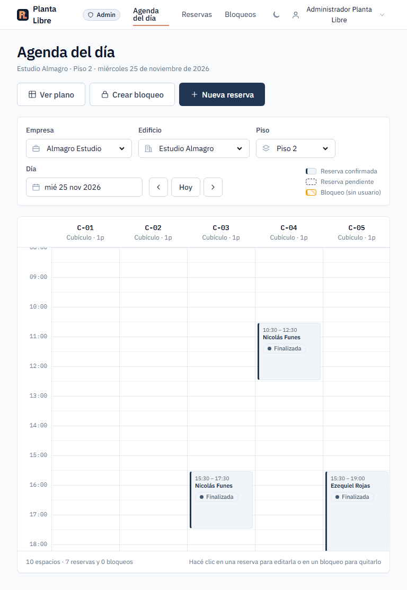 |

### 1280 px

| Pantalla | Captura |
| --- | --- |
| Ingreso | 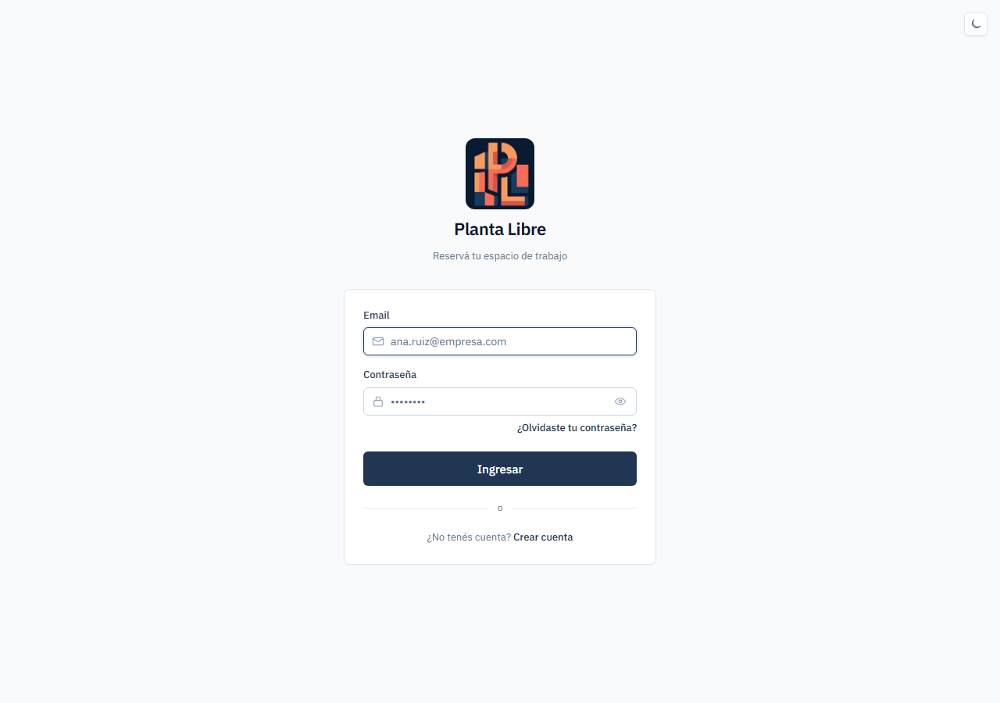 |
| Empresas | 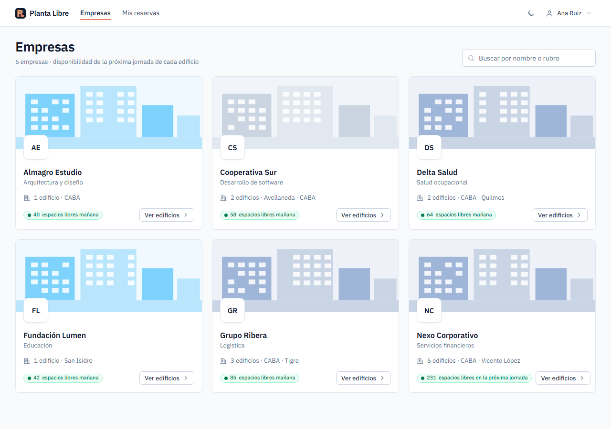 |
| Plano de un piso | 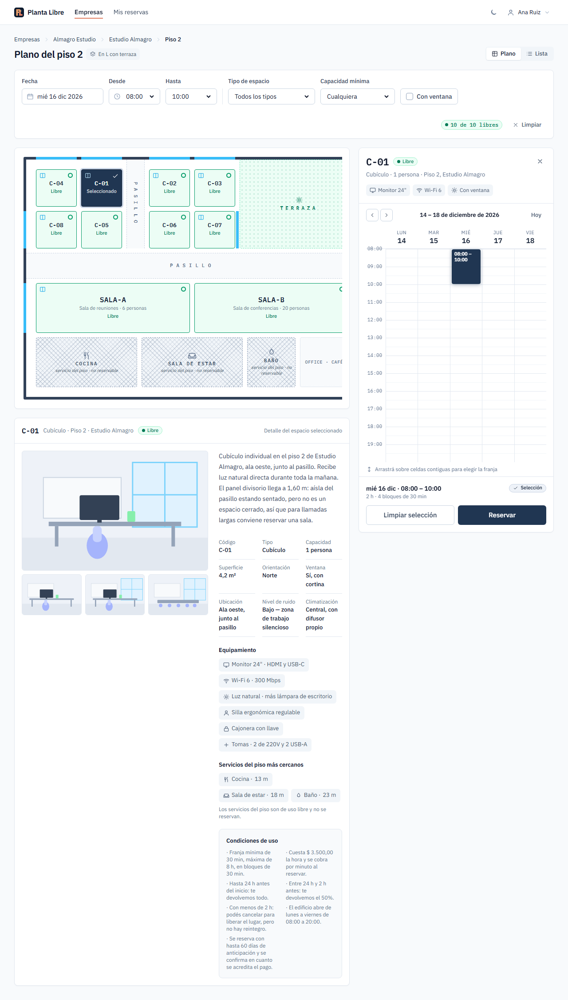 |
| Mis reservas | 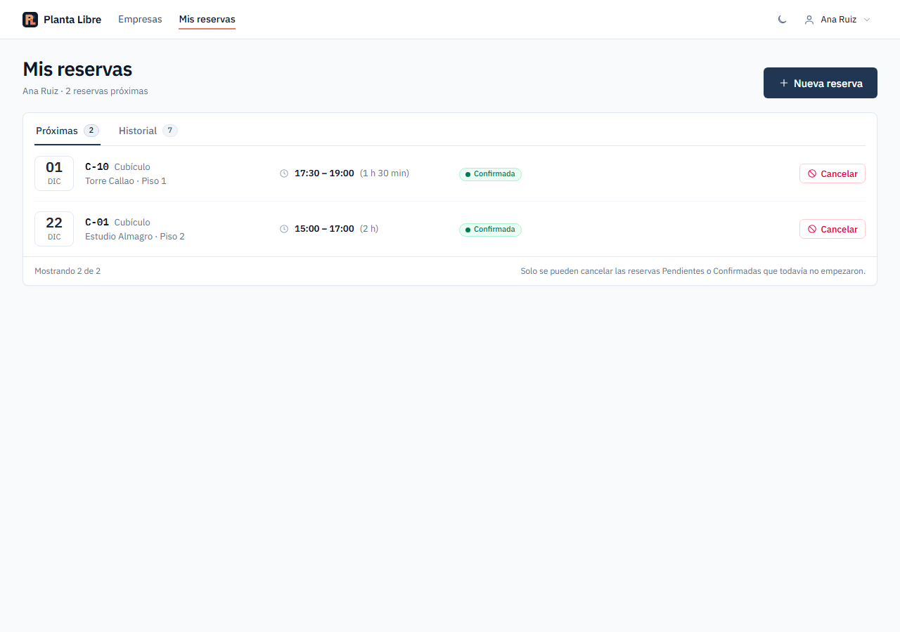 |
| Agenda del día | 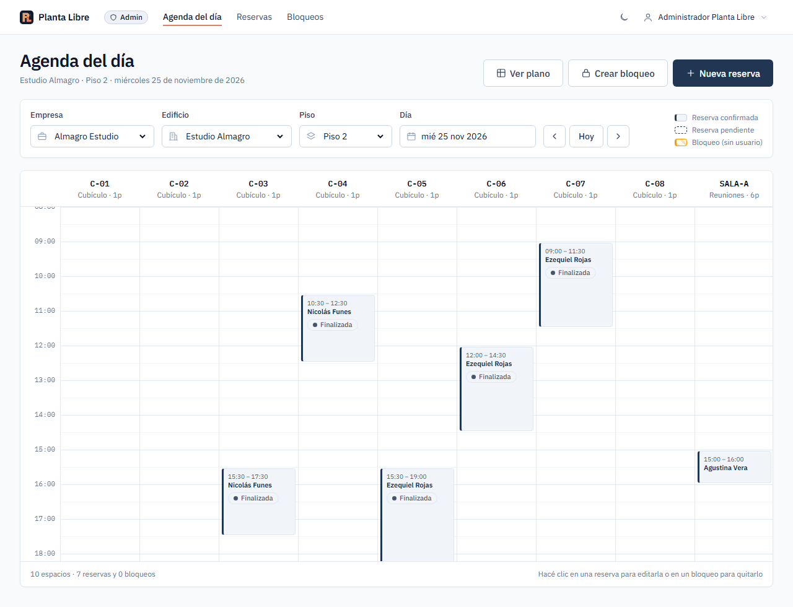 |

## Cómo reproducirlo

```bash
# 1) Sistema completo (API y front), desde la carpeta del backend
docker compose up -d --build

# 2) Suite end-to-end (incluye la auditoría de axe)
npm run e2e

# 3) Este informe: capturas, Lighthouse y docs/Accesibilidad.md
npm run a11y
```

Variables opcionales: `E2E_BASE_URL` (por defecto `http://localhost:8088`),
`E2E_API_URL` (`http://localhost:8080/api`) y `E2E_BACK_DIR` (ruta del repositorio del backend).
